<!--
  Generated by tools/build-profile.mjs. Edit the data there, then run:
    cd tools && npm install && npm run build
-->

  <a href="https://www.shrikumarsharma.in/"></a>

  <a href="https://www.shrikumarsharma.in/"></a>

<!-- Four buttons at 24.25% with three 1% gaps fill one row. -->

<!-- Uptime badge, hidden for now:

-->

<!-- Stats strip: values refreshed daily by .github/workflows/profile-stats.yml (last good values in assets/stats.json). -->

<a href="https://github.com/shreesharma07"></a>



<a href="https://github.com/shreesharma07/numsy"></a>





<!--
  Both cards render at exactly 490x165 (stats: hide=contribs + line_height=24; top-langs compact caps at 165),
  so 49% + 2% spacer + 49%, with no whitespace between the tags, spans the streak card's full width.
-->

  

<!-- Animated contribution snake: .github/workflows/snake.yml refreshes ./assets/profile-snake every 12 hours. -->

  

<!-- 3D contribution city: .github/workflows/profile-3d.yml commits it to ./assets/profile-3d-contrib. -->

  <a href="https://github.com/shreesharma07">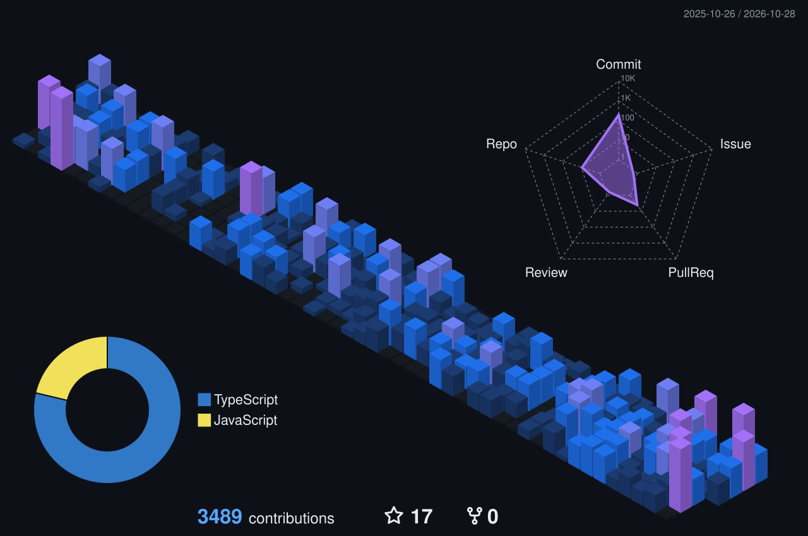</a>

  &nbsp;
  &nbsp;
  &nbsp;
  &nbsp;
  &nbsp;
  


<!-- Plain image rows instead of a table: table cells add 13px padding and would inset every chart. -->

<b>ALL TIME CODING ACTIVITY</b>

<!-- More chart types (editors, OS, categories): https://wakatime.com/share/embed, then add each share URL as a new <td>. -->


Open to collaboration and work inquiries. Pick whichever channel suits you.

<!-- Seven tiles at 13.4% with six 1.03% gaps fill one row. -->

<a href="https://www.shrikumarsharma.in/"></a><a href="https://blogs.shrikumarsharma.in/"></a><a href="https://www.linkedin.com/in/shreesharma07/"></a><a href="https://github.com/shreesharma07"></a><a href="https://wakatime.com/@shreesharma07"></a>


If my work has helped you, sponsoring me or buying me a coffee keeps it going. Thank you!

  

  &nbsp;
  &nbsp;
  &nbsp;
  &nbsp;
  

  

<a href="ShriKumarSharma-Resume.md"></a>

