<!--
  Generated by tools/build-profile.mjs. Edit the data there, then run:
    cd tools && npm install && npm run build
-->

  

  

  &nbsp;
  &nbsp;
  &nbsp;
  

  &nbsp;
  &nbsp;
  &nbsp;
  &nbsp;
  

  




<a href="https://one-cx.com/"></a>

<table align="center">
<tr>
<td width="66%" valign="top">
<ul>
<li>Sole backend owner of a multiplayer language-learning platform, built as a modular <b>NestJS</b> service.</li>
<li><b>Elasticsearch + Redis</b> search over <b>~12M</b> entries with <b>40%</b> lower latency.</li>
<li><b>BullMQ</b> workers took power-ups off the request path: <b>~35%</b> faster APIs.</li>
</ul>

More highlights

<ul>
<li><b>Socket.IO</b> gateway for live game state and matchmaking, with one consistent <code>${event}:error</code> contract.</li>
<li>Zero-downtime <b>TypeORM</b> migrations on PostgreSQL: nullable → backfill → constrain.</li>
<li><b>Prometheus + Grafana</b> cut incident detection time by <b>50%</b>; JWT, rate limiting, field-level encryption.</li>
<li>Bulk email service reaching <b>250K</b> recipients in under 10 minutes.</li>
</ul>

</td>
<td width="34%" valign="top" align="center">
<b>STACK</b>  

</td>
</tr>
</table>

<a href="https://one-cx.com/"></a>

<table align="center">
<tr>
<td width="66%" valign="top">
<ul>
<li>Only backend engineer on <b>INTERCOMM</b>, a WhatsApp Business API platform: <b>1M+</b> messages per quarter.</li>
<li><b>~100K messages/day per bot</b> at <b>99.9%</b> uptime on Redis-backed queues.</li>
<li><b>BridgeQ</b>: multi-channel messaging backbone on <b>Kafka</b> and <b>RabbitMQ</b>.</li>
</ul>

More highlights

<ul>
<li><b>10×</b> client reach, <b>2×</b> sales revenue and <b>+45%</b> campaign ROI in year one.</li>
<li>Provider-credential abstraction so new channels plug in without touching core logic.</li>
<li>Owned the <b>GitHub Actions</b> pipelines, Git workflow standards and runbooks.</li>
</ul>

</td>
<td width="34%" valign="top" align="center">
<b>STACK</b>  

</td>
</tr>
</table>

<table align="center">
<tr>
<td width="66%" valign="top">
<ul>
<li>Push-notification scheduler with personalised payloads and send-time selection.</li>
<li>Tuned <b>AWS RDS</b> and <b>Cassandra</b> for fast, highly available delivery.</li>
</ul>
</td>
<td width="34%" valign="top" align="center">
<b>STACK</b>  

</td>
</tr>
</table>

<table align="center">
<tr>
<td width="66%" valign="top">
<ul>
<li>Course-content REST APIs serving thousands of students daily.</li>
<li>Sole developer on <b>KYS</b>: encrypted APIs driven by database config, no deploy needed.</li>
<li>★ <b>PrepStar of the Quarter</b>, Q2 2022.</li>
</ul>
</td>
<td width="34%" valign="top" align="center">
<b>STACK</b>  

</td>
</tr>
</table>


<table align="center">
<tr>
<td width="50%" valign="top" align="center">

  

  
</td>
<td width="50%" valign="top" align="center">

  

  
</td>
</tr>
<tr>
<td width="50%" valign="top" align="center">

  

  
</td>
<td width="50%" valign="top" align="center">

  

  
</td>
</tr>
</table>


  &nbsp;
  &nbsp;
  &nbsp;
  &nbsp;
  &nbsp;
  &nbsp;
  &nbsp;
  &nbsp;
  &nbsp;
  

  &nbsp;
  &nbsp;
  &nbsp;
  &nbsp;
  &nbsp;
  &nbsp;
  &nbsp;
  &nbsp;
  &nbsp;
  

<table align="center">
<tr>
<td align="center"> <b>BACKEND &AMP; APIS</b>  

  
</td>
</tr>
<tr>
<td align="center"> <b>DATABASES &AMP; ORMS</b>  

  
</td>
</tr>
<tr>
<td align="center"> <b>MESSAGING &AMP; SEARCH</b>  

  
</td>
</tr>
<tr>
<td align="center"> <b>CLOUD &AMP; DELIVERY</b>  
<a href="https://aws.amazon.com"><img src="https://img.shields.io/badge/AWS-161b22?style=for-the-badge&logo=data%3Aimage%2Fsvg%2Bxml%3Bbase64%2CPHN2ZyBmaWxsPSIjRkY5OTAwIiByb2xlPSJpbWciIHZpZXdCb3g9IjAgMCAyNCAyNCIgeG1sbnM9Imh0dHA6Ly93d3cudzMub3JnLzIwMDAvc3ZnIj48dGl0bGU%2BQW1hem9uIEFXUzwvdGl0bGU%2BPHBhdGggZD0iTTYuNzYzIDEwLjAzNmMwIC4yOTYuMDMyLjUzNS4wODguNzEuMDY0LjE3Ni4xNDQuMzY4LjI1Ni41NzYuMDQuMDYzLjA1Ni4xMjcuMDU2LjE4MyAwIC4wOC0uMDQ4LjE2LS4xNTIuMjRsLS41MDMuMzM1YS4zODMuMzgzIDAgMCAxLS4yMDguMDcyYy0uMDggMC0uMTYtLjA0LS4yMzktLjExMmEyLjQ3IDIuNDcgMCAwIDEtLjI4Ny0uMzc1IDYuMTggNi4xOCAwIDAgMS0uMjQ4LS40NzFjLS42MjIuNzM0LTEuNDA1IDEuMTAxLTIuMzQ3IDEuMTAxLS42NyAwLTEuMjA1LS4xOTEtMS41OTYtLjU3NC0uMzkxLS4zODQtLjU5LS44OTQtLjU5LTEuNTMzIDAtLjY3OC4yMzktMS4yMy43MjYtMS42NDQuNDg3LS40MTUgMS4xMzMtLjYyMyAxLjk1NS0uNjIzLjI3MiAwIC41NTEuMDI0Ljg0Ni4wNjQuMjk2LjA0LjYuMTA0LjkxOC4xNzZ2LS41ODNjMC0uNjA3LS4xMjctMS4wMy0uMzc1LTEuMjc3LS4yNTUtLjI0OC0uNjg2LS4zNjctMS4zLS4zNjctLjI4IDAtLjU2OC4wMzEtLjg2My4xMDMtLjI5NS4wNzItLjU4My4xNi0uODYyLjI3MmEyLjI4NyAyLjI4NyAwIDAgMS0uMjguMTA0LjQ4OC40ODggMCAwIDEtLjEyNy4wMjNjLS4xMTIgMC0uMTY4LS4wOC0uMTY4LS4yNDd2LS4zOTFjMC0uMTI4LjAxNi0uMjI0LjA1Ni0uMjhhLjU5Ny41OTcgMCAwIDEgLjIyNC0uMTY3Yy4yNzktLjE0NC42MTQtLjI2NCAxLjAwNS0uMzZhNC44NCA0Ljg0IDAgMCAxIDEuMjQ2LS4xNTFjLjk1IDAgMS42NDQuMjE2IDIuMDkxLjY0Ny40MzkuNDMuNjYyIDEuMDg1LjY2MiAxLjk2M3YyLjU4NnptLTMuMjQgMS4yMTRjLjI2MyAwIC41MzQtLjA0OC44MjItLjE0NC4yODctLjA5Ni41NDMtLjI3MS43NTgtLjUxLjEyOC0uMTUyLjIyNC0uMzIuMjcyLS41MTIuMDQ3LS4xOTEuMDgtLjQyMy4wOC0uNjk0di0uMzM1YTYuNjYgNi42NiAwIDAgMC0uNzM1LS4xMzYgNi4wMiA2LjAyIDAgMCAwLS43NS0uMDQ4Yy0uNTM1IDAtLjkyNi4xMDQtMS4xOS4zMi0uMjYzLjIxNS0uMzkuNTE4LS4zOS45MTcgMCAuMzc1LjA5NS42NTUuMjk1Ljg0Ni4xOTEuMi40Ny4yOTYuODM4LjI5NnptNi40MS44NjJjLS4xNDQgMC0uMjQtLjAyNC0uMzA0LS4wOC0uMDY0LS4wNDgtLjEyLS4xNi0uMTY4LS4zMTFMNy41ODYgNS41NWExLjM5OCAxLjM5OCAwIDAgMS0uMDcyLS4zMmMwLS4xMjguMDY0LS4yLjE5MS0uMmguNzgzYy4xNTEgMCAuMjU1LjAyNS4zMS4wOC4wNjUuMDQ4LjExMy4xNi4xNi4zMTJsMS4zNDIgNS4yODQgMS4yNDUtNS4yODRjLjA0LS4xNi4wODgtLjI2NC4xNTEtLjMxMmEuNTQ5LjU0OSAwIDAgMSAuMzItLjA4aC42MzhjLjE1MiAwIC4yNTYuMDI1LjMyLjA4LjA2My4wNDguMTIuMTYuMTUxLjMxMmwxLjI2MSA1LjM0OCAxLjM4MS01LjM0OGMuMDQ4LS4xNi4xMDQtLjI2NC4xNi0uMzEyYS41Mi41MiAwIDAgMSAuMzExLS4wOGguNzQzYy4xMjcgMCAuMi4wNjUuMi4yIDAgLjA0LS4wMDkuMDgtLjAxNy4xMjhhMS4xMzcgMS4xMzcgMCAwIDEtLjA1Ni4ybC0xLjkyMyA2LjE3Yy0uMDQ4LjE2LS4xMDQuMjYzLS4xNjguMzExYS41MS41MSAwIDAgMS0uMzAzLjA4aC0uNjg3Yy0uMTUxIDAtLjI1NS0uMDI0LS4zMi0uMDgtLjA2My0uMDU2LS4xMTktLjE2LS4xNS0uMzJsLTEuMjM4LTUuMTQ4LTEuMjMgNS4xNGMtLjA0LjE2LS4wODcuMjY0LS4xNS4zMi0uMDY1LjA1Ni0uMTc3LjA4LS4zMi4wOHptMTAuMjU2LjIxNWMtLjQxNSAwLS44My0uMDQ4LTEuMjI5LS4xNDMtLjM5OS0uMDk2LS43MS0uMi0uOTE4LS4zMi0uMTI4LS4wNzEtLjIxNS0uMTUxLS4yNDctLjIyM2EuNTYzLjU2MyAwIDAgMS0uMDQ4LS4yMjR2LS40MDdjMC0uMTY3LjA2NC0uMjQ3LjE4My0uMjQ3LjA0OCAwIC4wOTYuMDA4LjE0NC4wMjQuMDQ4LjAxNi4xMi4wNDguMi4wOC4yNzEuMTIuNTY2LjIxNS44NzguMjc5LjMxOS4wNjQuNjMuMDk2Ljk1LjA5Ni41MDIgMCAuODk0LS4wODggMS4xNjUtLjI2NGEuODYuODYgMCAwIDAgLjQxNS0uNzU4Ljc3Ny43NzcgMCAwIDAtLjIxNS0uNTU5Yy0uMTQ0LS4xNTEtLjQxNi0uMjg3LS44MDctLjQxNWwtMS4xNTctLjM2Yy0uNTgzLS4xODMtMS4wMTQtLjQ1NC0xLjI3Ny0uODEzYTEuOTAyIDEuOTAyIDAgMCAxLS40LTEuMTU4YzAtLjMzNS4wNzMtLjYzLjIxNi0uODg2LjE0NC0uMjU1LjMzNS0uNDc5LjU3NS0uNjU0LjI0LS4xODQuNTEtLjMyLjgzLS40MTUuMzItLjA5Ni42NTUtLjEzNiAxLjAwNi0uMTM2LjE3NSAwIC4zNTkuMDA4LjUzNS4wMzIuMTgzLjAyNC4zNS4wNTYuNTE4LjA4OC4xNi4wNC4zMTIuMDguNDU1LjEyNy4xNDQuMDQ4LjI1Ni4wOTYuMzM2LjE0NGEuNjkuNjkgMCAwIDEgLjI0LjIuNDMuNDMgMCAwIDEgLjA3MS4yNjN2LjM3NWMwIC4xNjgtLjA2NC4yNTYtLjE4NC4yNTZhLjgzLjgzIDAgMCAxLS4zMDMtLjA5NiAzLjY1MiAzLjY1MiAwIDAgMC0xLjUzMi0uMzExYy0uNDU1IDAtLjgxNS4wNzEtMS4wNjIuMjIzLS4yNDguMTUyLS4zNzUuMzgzLS4zNzUuNzEgMCAuMjI0LjA4LjQxNi4yNC41NjcuMTU5LjE1Mi40NTQuMzA0Ljg3Ny40NGwxLjEzNC4zNThjLjU3NC4xODQuOTkuNDQgMS4yMzcuNzY3LjI0Ny4zMjcuMzY3LjcwMi4zNjcgMS4xMTcgMCAuMzQzLS4wNzIuNjU1LS4yMDcuOTI2LS4xNDQuMjcyLS4zMzYuNTExLS41ODMuNzAzLS4yNDguMi0uNTQzLjM0My0uODg2LjQ0Ny0uMzYuMTExLS43MzQuMTY3LTEuMTQyLjE2N3pNMjEuNjk4IDE2LjIwN2MtMi42MjYgMS45NC02LjQ0MiAyLjk2OS05LjcyMiAyLjk2OS00LjU5OCAwLTguNzQtMS43LTExLjg3LTQuNTI2LS4yNDctLjIyMy0uMDI0LS41MjcuMjcyLS4zNTEgMy4zODQgMS45NjMgNy41NTkgMy4xNTMgMTEuODc3IDMuMTUzIDIuOTE0IDAgNi4xMTQtLjYwNyA5LjA2LTEuODUyLjQzOS0uMi44MTQuMjg3LjM4My42MDd6TTIyLjc5MiAxNC45NjFjLS4zMzYtLjQzLTIuMjItLjIwNy0zLjA3NC0uMTAzLS4yNTUuMDMyLS4yOTUtLjE5Mi0uMDYzLS4zNiAxLjUtMS4wNTMgMy45NjctLjc1IDQuMjU0LS4zOTkuMjg3LjM2LS4wOCAyLjgyNi0xLjQ4NSA0LjAwNy0uMjE1LjE4NC0uNDIzLjA4OC0uMzI3LS4xNTEuMzItLjc5IDEuMDMtMi41Ny42OTUtMi45OTR6Ii8%2BPC9zdmc%2B" alt="AWS"></a>

  
</td>
</tr>
<tr>
<td align="center"> <b>OBSERVABILITY &AMP; TESTING</b>  

  
</td>
</tr>
<tr>
<td align="center"> <b>TOOLING</b>  

  
</td>
</tr>
<tr>
<td align="center"> <b>WEB, ANALYTICS &AMP; SEO</b>  

  
</td>
</tr>
<tr>
<td align="center"> <b>AI-ASSISTED</b>  

  
</td>
</tr>
<tr>
<td align="center"> <b>ALSO SHIPPED WITH</b>  

  
</td>
</tr>
</table>


  &nbsp;
  &nbsp;
  &nbsp;
  &nbsp;
  &nbsp;
  

  &nbsp;
  &nbsp;
  &nbsp;
  


<!--
  Both cards render at exactly 490x165 (stats: hide=contribs + line_height=24; top-langs compact caps at 165),
  so 49% + 2% spacer + 49%, with no whitespace between the tags, spans the streak card's full width.
-->

  

<!-- Animated contribution snake: .github/workflows/snake.yml refreshes ./profile-snake every 12 hours. -->

  

<!-- 3D contribution calendar: .github/workflows/profile-3d.yml commits it to ./profile-3d-contrib. -->

  <a href="https://github.com/shreesharma07">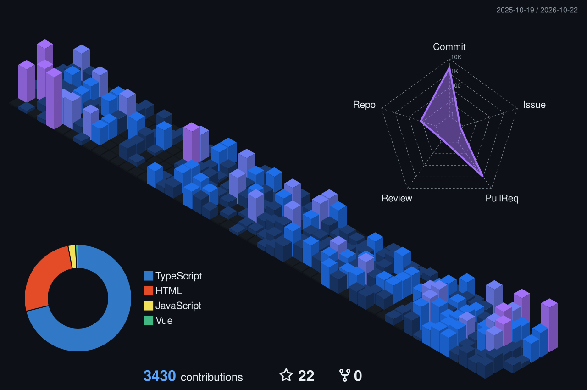</a>

  &nbsp;
  &nbsp;
  &nbsp;
  &nbsp;
  &nbsp;
  


<table align="center">
<tr>
<td colspan="2" align="center"></td>
</tr>
<tr>
<td width="50%" align="center" valign="top"><b>LANGUAGES · SHARE</b>  </td>
<td width="50%" align="center" valign="top"><b>LANGUAGES · HOURS</b>  </td>
</tr>
<tr>
<td colspan="2" align="center"><b>ALL TIME CODING ACTIVITY</b>  </td>
</tr>
</table>
<!-- More chart types (editors, OS, categories): https://wakatime.com/share/embed, then add each share URL as a new <td>. -->


  
   Best-performing individual in the backend engineering team for the quarter.

<table align="center">
<tr>
<td width="36%" align="center" valign="top"><b>ANTHROPIC</b>  
 
 
 

</td>
<td width="32%" align="center" valign="top"><b>HACKERRANK</b>  
 
 
 

</td>
<td width="32%" align="center" valign="top"><b>OTHER</b>  
 
 

</td>
</tr>
</table>

<!-- Holopin board, hidden for now:

  

-->


  
  



Open to collaboration and work inquiries. Pick whichever channel suits you.

<!-- Seven tiles at 13.4% with six 1.03% spacers fill one row; no whitespace between tags. -->


If my work has helped you, sponsoring me or buying me a coffee keeps it going. Thank you!

  

  &nbsp;
  &nbsp;
  &nbsp;
  &nbsp;
  

  

<a href="#top">↑ back to top</a>

