<!--
  Generated by tools/build-profile.mjs. Edit the data there, then run:
    cd tools && npm install && npm run build
-->

<a href="https://res.cloudinary.com/dlm7asyya/image/upload/v1792392565/ShriKumarSharma_BackendEngineer_SDE3_Resume_v5_feungf.pdf"></a>


<a href="https://www.prepladder.com"></a>

<a href="https://www.prepladder.com"></a>







<!-- Learning-resource chips, hidden for now:

  &nbsp;
  &nbsp;
  &nbsp;
  &nbsp;
  &nbsp;
  

  &nbsp;
  &nbsp;
  &nbsp;
  

-->








<a href="https://www.linkedin.com/in/shreesharma07/details/certifications/"></a>

<!-- Holopin board, hidden for now:

  

-->


<a href="https://www.cbse.gov.in"></a>



<a href="#top"></a>

