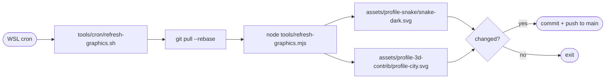

# Contribution graphics on a WSL cron

`refresh-graphics.sh` regenerates the contribution snake and the 3D city, then commits and pushes them to `main`. It replaces `snake.yml` and `profile-3d.yml`. The stats strip is handled separately by [gh-profile-worker](../../workers/gh-profile-worker), which never touches these two files.



## One-time setup in WSL

1. **Node 22 or newer and git.** Use any install (apt, nvm or fnm); the script loads nvm and fnm itself when cron's bare `PATH` cannot find `node`.

2. **A dedicated clone.** The script pulls and commits on its own, so give it a checkout you do not edit in. Keep it on the Linux filesystem, not under `/mnt/d`, which is slow:

   ```bash
   git clone https://github.com/shreesharma07/shreesharma07.git ~/cron/shreesharma07
   ```

3. **Push access without prompts.** Cron cannot type a password. Either run `gh auth login` and then `gh auth setup-git`, or use an SSH remote with a key that has no passphrase. Then check:

   ```bash
   cd ~/cron/shreesharma07 && git push --dry-run
   ```

4. **A token for the generators,** which read your contribution calendar. Any token that can read public profile data works, including the gh-profile-worker PAT:

   ```bash
   printf 'GITHUB_TOKEN=%s\n' 'github_pat_...' > ~/cron/shreesharma07/tools/.env
   chmod 600 ~/cron/shreesharma07/tools/.env      # git-ignored
   ```

5. **A dry run by hand.** This generates and commits but does not push:

   ```bash
   ~/cron/shreesharma07/tools/cron/refresh-graphics.sh --no-push
   ```

6. **Install the schedule.** The default runs at 06:05 and 18:05 in the distro's time zone:

   ```bash
   ~/cron/shreesharma07/tools/cron/install-cron.sh
   # or your own schedule:
   ~/cron/shreesharma07/tools/cron/install-cron.sh "35 */6 * * *"
   ```

7. **Make sure cron runs.** On WSL with systemd (`[boot] systemd=true` in `/etc/wsl.conf`):

   ```bash
   sudo systemctl enable --now cron
   ```

   Without systemd, run `sudo service cron start` after each WSL start.

## Day to day

| Task | Command |
| --- | --- |
| Run now | `~/cron/shreesharma07/tools/cron/refresh-graphics.sh` |
| One graphic only | `cd ~/cron/shreesharma07/tools && node refresh-graphics.mjs snake` (or `city`) |
| Watch the log | `tail -f ~/.local/state/profile-graphics.log` |
| See the entry | `crontab -l` |
| Remove the entry | `~/cron/shreesharma07/tools/cron/install-cron.sh --remove` |

## Things to know

- **WSL has to be running.** Cron only fires while the distro is up. If WSL has shut down (Windows asleep, or WSL idle), that run is skipped. The next one catches up, because each run regenerates from the live contribution data.
- **Failures are safe.** A generator that fails keeps the old image. The other graphic is still committed, and the script exits non-zero so the log shows it.
- **The 3D generator is pinned.** It runs `yoshi389111/github-profile-3d-contrib` `v0.9.3` and checks the tag's commit (`7d95e7d`) before running it with your token. To upgrade, change `CITY.tag` and `CITY.commit` in `tools/refresh-graphics.mjs`.
- **The snake generator is pinned too:** `generate-snake-animation` is fixed at `3.5.0` in `tools/package.json`.
- **The Actions are still in the repo.** Disable them so they do not commit the same files: `gh workflow disable snake.yml` and `gh workflow disable profile-3d.yml`. Both are reversible with `gh workflow enable`.
