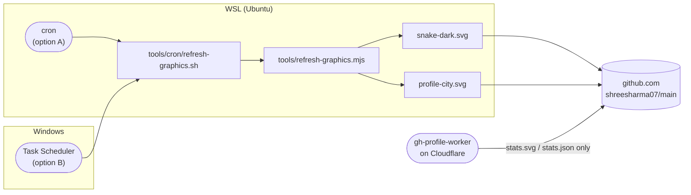

# WSL setup: contribution graphics on a schedule

This guide sets up a Windows machine to regenerate the profile's **contribution snake** and **3D contribution city** on a schedule, then commit and push them to `shreesharma07/shreesharma07`. It replaces the `snake.yml` and `profile-3d.yml` GitHub Actions.

- [Part 1: First installation](#part-1-first-installation) is done once, top to bottom (about 20 minutes).
- [Part 2: Follow-up](#part-2-follow-up) covers day-to-day use, changes and maintenance.
- [Part 3: Troubleshooting](#part-3-troubleshooting) lists symptoms and fixes.

## How it fits together



| Piece | What it does |
| --- | --- |
| `tools/refresh-graphics.mjs` | Generates both SVGs into `assets/` with the same settings the workflows used. A generator that fails keeps the old image. |
| `tools/cron/refresh-graphics.sh` | The scheduled entry point. It takes a lock, pulls, installs dependencies when needed, generates, commits only changed files, and pushes (retrying if needed). |
| `tools/cron/install-cron.sh` | Adds, updates or removes the crontab entry. Safe to re-run. |
| gh-profile-worker | Refreshes the stats strip from Cloudflare. It never touches these two files, so the two never collide. |

---

## Part 1: First installation

### Before you start

You need:

- Windows 10 22H2 or Windows 11, with WSL 2 and an Ubuntu distro
- push access to `shreesharma07/shreesharma07`
- a GitHub token that can read your public profile. The fine-grained PAT used by gh-profile-worker works.

Unless a step says **PowerShell**, run every command in a **WSL terminal**. To open one, start PowerShell and type `wsl`.

---

### Step 1: Install or check WSL

**Why:** cron and the scripts run inside Linux.

In **PowerShell**:

```powershell
wsl --status
wsl -l -v
```

If WSL is missing, or no Ubuntu distro is listed, install it, restart when asked, and create a Linux user:

```powershell
wsl --install -d Ubuntu
```

**Check:** `wsl -l -v` lists `Ubuntu` with `VERSION 2`. Note the exact distro name (for example `Ubuntu` or `Ubuntu-24.04`); option B in step 10 needs it.

---

### Step 2: Install the Linux packages

**Why:** the scripts need `git`, `cron`, `curl`, `flock` and `sha256sum` (the last two ship with Ubuntu), plus the GitHub CLI for login.

```bash
sudo apt update
sudo apt install -y git cron curl ca-certificates gh
```

**Check:**

```bash
git --version && gh --version && command -v flock sha256sum
```

> If `gh` is too old for `gh auth login` or is missing, install the current release from <https://github.com/cli/cli/blob/trunk/docs/install_linux.md>.

---

### Step 3: Install Node.js 22 or newer

**Why:** both generators are Node programs. The script loads nvm by itself, so Node installed through nvm works even though cron starts with an almost empty `PATH`.

```bash
curl -o- https://raw.githubusercontent.com/nvm-sh/nvm/v0.40.3/install.sh | bash
source ~/.bashrc
nvm install 22
nvm alias default 22
```

**Check:**

```bash
node --version    # v22.x or newer
npm --version
```

---

### Step 4: Turn on systemd so cron starts by itself

**Why:** without systemd, cron has to be started by hand every time WSL starts.

See whether it is already on:

```bash
ps -p 1 -o comm=
```

- If it prints `systemd`, skip to step 5.
- If not, enable it:

  ```bash
  printf '[boot]\nsystemd=true\n' | sudo tee /etc/wsl.conf
  ```

  Then restart WSL from **PowerShell** and open `wsl` again:

  ```powershell
  wsl --shutdown
  ```

**Check:** `ps -p 1 -o comm=` now prints `systemd`.

> If `/etc/wsl.conf` already has other settings, add the `[boot]` section by hand instead of overwriting the file: `sudo nano /etc/wsl.conf`.

---

### Step 5: Start cron and set the time zone

**Why:** cron reads its schedule in the distro's local time.

```bash
sudo systemctl enable --now cron
sudo timedatectl set-timezone Asia/Kolkata
```

**Check:**

```bash
systemctl status cron --no-pager    # Active: active (running)
date                                # shows IST
```

---

### Step 6: Give git push access without a prompt

**Why:** a scheduled job cannot type a password. `gh` stores a credential that git then uses.

```bash
gh auth login
```

Answer the prompts: **GitHub.com**, then **HTTPS**, then **Yes** (authenticate git), then **Login with a web browser**. Copy the one-time code into the browser.

```bash
gh auth setup-git
git config --global user.name  "Shree Kumar Sharma"
git config --global user.email "<the email on your GitHub account>"
```

**Check:**

```bash
gh auth status    # Logged in to github.com
```

---

### Step 7: Make a dedicated clone

**Why:** the script pulls, commits and pushes on its own. Give it a checkout you never edit in, so it can't disturb your work. Keep it on the Linux filesystem (`~`), not under `/mnt/d`, where git is slow and file modes get lost.

```bash
git clone https://github.com/shreesharma07/shreesharma07.git ~/cron/shreesharma07
cd ~/cron/shreesharma07
git push --dry-run
```

**Check:** `git push --dry-run` prints `Everything up-to-date` without asking for credentials, and the scripts are executable:

```bash
ls -l tools/cron/*.sh    # -rwxr-xr-x ...
```

---

### Step 8: Store the token for the generators

**Why:** both generators read your contribution calendar through the GitHub API. `refresh-graphics.mjs` looks for `GITHUB_TOKEN` in the environment, then `GITHUB_TOKEN` or `GH_TOKEN` in `tools/.env`.

```bash
printf 'GITHUB_TOKEN=%s\n' 'github_pat_PASTE_YOURS_HERE' > ~/cron/shreesharma07/tools/.env
chmod 600 ~/cron/shreesharma07/tools/.env
```

**Check:**

```bash
git -C ~/cron/shreesharma07 check-ignore tools/.env    # prints tools/.env, so it is ignored
```

> The token only needs to read public profile data. Never commit `tools/.env`.

---

### Step 9: Do a first run by hand, without pushing

**Why:** this proves Node, the token, the generators and git all work before anything runs unattended. The first run also installs the tools' npm dependencies and downloads the pinned 3D generator (`v0.9.3`, verified against commit `7d95e7d`).

```bash
~/cron/shreesharma07/tools/cron/refresh-graphics.sh --no-push
```

Expected output (timestamps differ):

```text
2026-10-26T08:10:00Z updating /home/<you>/cron/shreesharma07 (main)
2026-10-26T08:10:05Z installing tools dependencies
token from /home/<you>/cron/shreesharma07/tools/.env
snake: updated
city: updated
2026-10-26T08:11:30Z committed abc1234
```

**Check:**

```bash
git -C ~/cron/shreesharma07 log --oneline -1    # chore: refresh contribution graphics
git -C ~/cron/shreesharma07 status -sb          # ahead of origin/main by 1
```

The commit stays local; the first scheduled run pushes it. To push it now, run the script once without `--no-push`.

---

### Step 10: Schedule it

Pick **one** option. Option A is the plain cron setup. Option B is more reliable on a laptop, because it does not depend on WSL already running.

#### Option A: cron inside WSL

```bash
~/cron/shreesharma07/tools/cron/install-cron.sh
```

This installs `5 6,18 * * *` (06:05 and 18:05 IST) and writes logs to `~/.local/state/profile-graphics.log`. For another schedule, pass it as an argument:

```bash
~/cron/shreesharma07/tools/cron/install-cron.sh "35 */6 * * *"    # every 6 hours at :35
```

**Check:**

```bash
crontab -l    # one line ending in "# shreesharma07-profile-graphics"
```

**Prove cron really fires.** Run every 5 minutes, watch one run, then restore the normal schedule:

```bash
~/cron/shreesharma07/tools/cron/install-cron.sh "*/5 * * * *"
tail -f ~/.local/state/profile-graphics.log    # wait for a run, then Ctrl+C
~/cron/shreesharma07/tools/cron/install-cron.sh
```

> **The catch:** WSL shuts down a little after its last terminal closes, and cron stops with it, so runs are skipped while WSL is not running. Each run regenerates from live data, so the next run catches up. If that is not good enough, use option B.

#### Option B: Windows Task Scheduler starts each run

Windows wakes WSL for every run, so no terminal needs to be open. First, in WSL, create the log folder (option A's installer would do this for you):

```bash
mkdir -p ~/.local/state
```

Then in **PowerShell**, replacing `Ubuntu` with your distro name from step 1:

```powershell
schtasks /Create /TN "ProfileGraphics" /SC HOURLY /MO 12 /ST 06:05 /TR "wsl.exe -d Ubuntu -- bash -lc '~/cron/shreesharma07/tools/cron/refresh-graphics.sh >> ~/.local/state/profile-graphics.log 2>&1'"
```

This runs at 06:05 and 18:05 while you are logged in to Windows. Check it with:

```powershell
schtasks /Query /TN "ProfileGraphics" /V /FO LIST
schtasks /Run /TN "ProfileGraphics"    # run once now
```

If you use option B, make sure no WSL cron entry exists, so the job does not run twice:

```bash
~/cron/shreesharma07/tools/cron/install-cron.sh --remove
```

---

### Step 11: Turn off the old GitHub Actions

**Why:** otherwise Actions and your scheduled job both commit the same files. Disabling keeps the workflow files and can be undone.

```bash
gh workflow disable snake.yml         -R shreesharma07/shreesharma07
gh workflow disable profile-3d.yml    -R shreesharma07/shreesharma07
gh workflow disable profile-stats.yml -R shreesharma07/shreesharma07    # the stats strip is now the Worker's job
```

**Check:**

```bash
gh workflow list -R shreesharma07/shreesharma07    # all three show "disabled_manually"
```

---

### First-installation checklist

- [ ] `node --version` is 22 or newer
- [ ] `ps -p 1 -o comm=` prints `systemd`, and `systemctl status cron` is active (option A)
- [ ] `gh auth status` is logged in, and `git push --dry-run` works without a prompt
- [ ] `~/cron/shreesharma07/tools/.env` exists with mode `600`
- [ ] the manual `--no-push` run printed `snake:` and `city:` lines and made a commit
- [ ] `crontab -l` shows the entry (A), or `schtasks /Query /TN ProfileGraphics` shows the task (B), but not both
- [ ] the three workflows are disabled

---

## Part 2: Follow-up

### Daily use

Nothing to do. Each run pulls, regenerates, and commits and pushes only when an image changed. To keep an eye on it:

```bash
tail -n 30 ~/.local/state/profile-graphics.log
git -C ~/cron/shreesharma07 log --oneline -5
```

A healthy run ends with `pushed to origin/main` or `graphics unchanged, nothing to commit`.

### Run it now

```bash
~/cron/shreesharma07/tools/cron/refresh-graphics.sh                  # generate, commit, push
~/cron/shreesharma07/tools/cron/refresh-graphics.sh --no-push        # commit only
cd ~/cron/shreesharma07/tools && node refresh-graphics.mjs snake     # one graphic, no commit
```

### Change the schedule

Option A:

```bash
~/cron/shreesharma07/tools/cron/install-cron.sh "0 */4 * * *"    # replaces the old entry
```

Option B, in PowerShell:

```powershell
schtasks /Change /TN "ProfileGraphics" /ST 07:00
```

### Rotate the GitHub token

When the PAT nears its expiry, create a new one and overwrite the file:

```bash
printf 'GITHUB_TOKEN=%s\n' 'github_pat_NEW' > ~/cron/shreesharma07/tools/.env
chmod 600 ~/cron/shreesharma07/tools/.env
```

If it is the same PAT the Worker uses, update that too: `pnpm wrangler secret put GH_TOKEN` in `workers/gh-profile-worker`, and its `.env`.

### Pick up changes to the scripts

There's nothing to do: every run starts with `git pull --rebase`, so changes you push to `tools/` are used from the next run on. If `tools/package-lock.json` changed, the script runs `npm ci` by itself.

### Upgrade a generator

- **Snake:** change the `generate-snake-animation` version in `tools/package.json`, run `npm install` in `tools/`, then commit and push. The cron clone picks it up on its next pull.
- **3D city:** update `CITY.tag` and `CITY.commit` in `tools/refresh-graphics.mjs`. Get the commit with `git ls-remote https://github.com/yoshi389111/github-profile-3d-contrib.git refs/tags/<tag>`. Then commit and push. The old checkout in `tools/.cache` is replaced automatically when the tag changes.

### Pause or remove the job

```bash
~/cron/shreesharma07/tools/cron/install-cron.sh --remove    # option A
```

```powershell
schtasks /Change /TN "ProfileGraphics" /DISABLE    # option B, pause
schtasks /Delete /TN "ProfileGraphics" /F          # option B, remove
```

To hand the work back to GitHub Actions:

```bash
gh workflow enable snake.yml      -R shreesharma07/shreesharma07
gh workflow enable profile-3d.yml -R shreesharma07/shreesharma07
```

### After a Windows or WSL update

```bash
systemctl status cron --no-pager    # option A: still active?
crontab -l                          # entry still there?
node --version                      # nvm Node still present?
```

### Start over cleanly

```bash
~/cron/shreesharma07/tools/cron/install-cron.sh --remove
rm -rf ~/cron/shreesharma07 ~/.local/state/profile-graphics.log
```

Then repeat steps 7 to 10.

---

## Part 3: Troubleshooting

| Symptom (in the log or terminal) | Cause | Fix |
| --- | --- | --- |
| `node not found on PATH` | cron cannot see Node | Install Node with nvm (step 3) or apt. The script loads `~/.nvm/nvm.sh` itself |
| Nothing in the log at the scheduled time | cron not running, WSL not running, or the time zone differs | `systemctl status cron`, `date`, `crontab -l`. Consider option B |
| `no GitHub token` | `tools/.env` missing or misnamed | Redo step 8 in the cron clone |
| `snake: failed` or `city: failed` with HTTP 401 | token expired or revoked | Rotate the token (Part 2) |
| `... is <sha>, expected 7d95e7d...; refusing to run it` | the 3D generator's tag was moved upstream | Check the upstream release, then update `CITY.commit` deliberately |
| `push rejected` three times, then `push failed` | `main` is protected, or credentials expired | `gh auth status`, then `gh auth login`. Allow pushes to `main` for your account |
| `another run is in progress, skipping` | a previous run is still going | Normal. If it keeps happening, look for a stuck `node` with `ps aux \| grep refresh` |
| `error: cannot pull with rebase: You have unstaged changes` | someone edited files in the cron clone | Don't work in `~/cron/shreesharma07`. Run `git -C ~/cron/shreesharma07 status`, then commit or discard there |
| `$'\r': command not found` | the script was saved with Windows line endings | Use a fresh clone from step 7; `.gitattributes` keeps `*.sh` as LF |
| Images update but the profile looks the same | GitHub's image cache | Wait a few minutes or hard-refresh; the commit is what matters |
